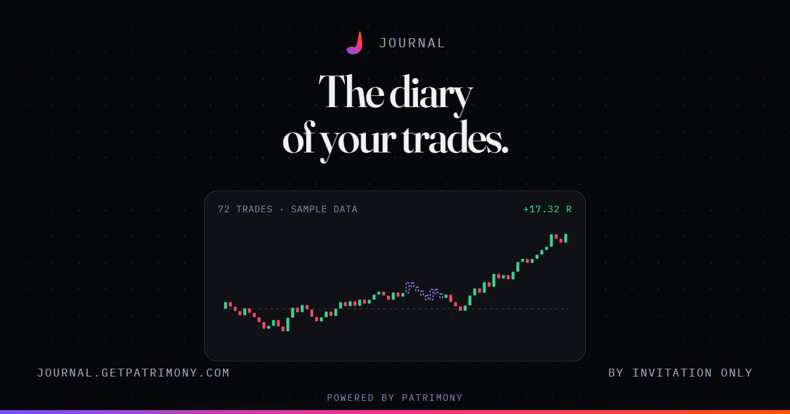
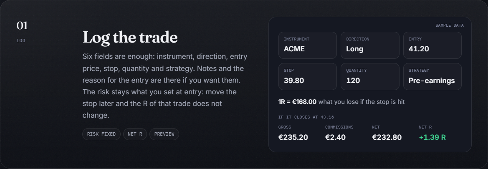
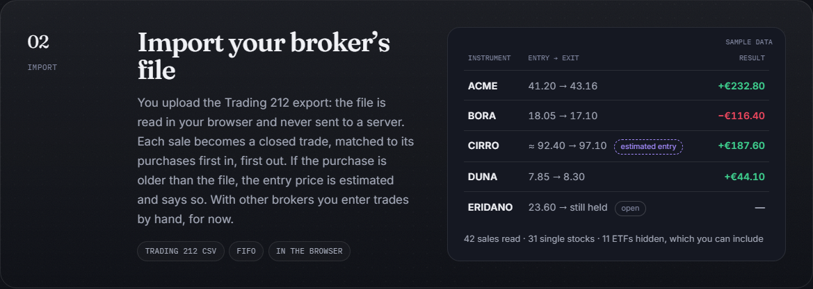
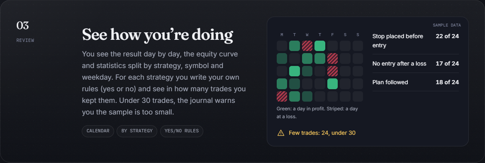

  

<h3 align="center">The diary of your trades. Every number says where it comes from.</h3>

  
  
  
  
  

  <a href="https://journal.getpatrimony.com/en/">Journal site</a> ·
  <a href="#why-another-journal">Why</a> ·
  <a href="#how-it-works">How it works</a> ·
  <a href="#whats-in-today">What's in</a> ·
  <a href="#get-in">Get in</a> ·
  <a href="#about-this-repository">About this repo</a>

  

**Journal, powered by [Patrimony](https://getpatrimony.com)**, is a trading journal. You log each trade, import your broker's file, and see how you are really doing: your average result, how much you risk, where you lose. When a number is an estimate, it says so.

> **Status:** alpha, by invitation only. The price is not decided, and neither is what will be free and what Premium. The trades and figures on the Journal's site are samples.

## Why another journal

Most journals show a number and let you believe it. This one separates three cases and shows them differently:

| | What it means |
|---|---|
| **Measured** | A true R. The risk is the one you set at entry and does not change if you move the stop later. |
| **Estimated** | If you did not save a stop, 1R becomes your average loss. It is a calculation you can redo by hand, not a true R, and it says so. |
| **Careful** | Few trades. Under 30, statistics swing around, and the journal tells you. |

No artificial intelligence: the statistics are calculations you can redo. No signals and no advice: the journal records and analyses your trades, it does not tell you what to buy.

## How it works

From a single trade to the review, in three steps. Every picture below is the Journal's own page, with sample data.

  

**1. Log.** Six fields are enough. The risk stays what you set at entry: move the stop later and the R of that trade does not change.

  

**2. Import.** The Trading 212 export is read in your browser and never sent to a server. Each sale becomes a closed trade matched to its purchases, first in, first out. If the purchase is older than the file, the entry is estimated and says so.

  

**3. Review.** The result day by day, the equity curve, and statistics by strategy, symbol and weekday. You write your own rules and see in how many trades you kept them. Under 30 trades, the journal warns you the sample is too small.
## What's in today

Everything below is in the alpha. Nothing here is a promise.

| Area | What you get |
|---|---|
| **Logging** | Quick entry with a preview of gross, net and R. Six fields are enough: instrument, direction, entry price, stop, quantity, strategy. Partial exits on the same trade. |
| **Review** | A trade list grouped by day, a results calendar, and an overview with net result, equity curve, win rate, expectancy, profit factor, payoff, average R and drawdown. |
| **Charts** | Result per trade, duration, symbol, outcomes. |
| **Statistics** | By strategy, symbol, weekday, long/short and plan followed. A strategy filter across the whole overview. |
| **Rules** | Your own yes/no rules, checked on every trade, with how you do when you keep them and when you don't. |
| **Import** | Trading 212 export (CSV), read in your browser and never sent to a server. Each sale becomes a closed trade, matched to its purchases first in, first out; an old purchase gets an estimated entry that says so. It also updates trades you still hold. |
| **Privacy** | A privacy mode to hide the figures. Data stored in the EU (Frankfurt). No advertising. |
| **Languages** | Italian and English. |

**Not yet:** a link to a Patrimony account to see trade results next to your net worth; a guided review and a screenshot for each trade; import from other brokers (only after testing on real files).

## Get in

For now entry is **by invitation only**. Ask for access on the [Journal site](https://journal.getpatrimony.com/en/) or write to [contact@getpatrimony.com](mailto:contact@getpatrimony.com) and you will get a reply.

## About this repository

This repository is only the Journal's shop window: **there is no code here**, and the Journal is not open source. It used to be an open-source trading journal also called TradeDiary; that plan was dropped in favour of the Journal. The old code is not lost: it is kept untouched on the [`archive/open-source-app`](https://github.com/Flaeren/TradeDiary/tree/archive/open-source-app) branch.

---

Made by Gabriele Denaro · <a href="https://github.com/Flaeren">GitHub: Flaeren</a> · <a href="https://gabrieledenaro.com">gabrieledenaro.com</a>

